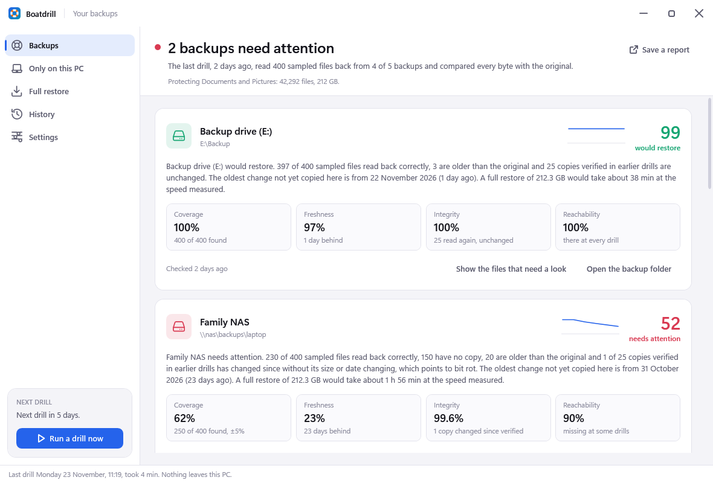
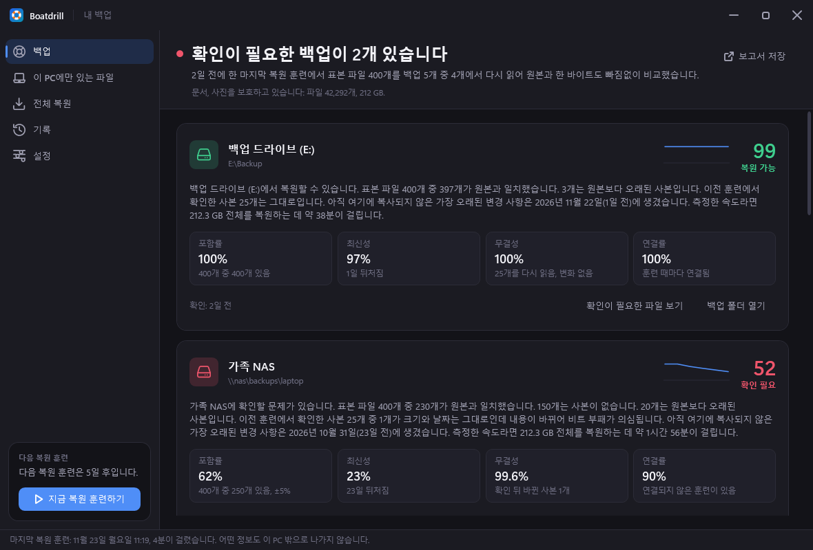

# Boatdrill

A backup you have never restored from is a hope, not a backup. Boatdrill is a small Windows app that
rehearses restoring from your backups on a schedule and says, in plain words, whether they would work.

Boatdrill is a [Project Max](https://projectmax-org.github.io) application: free, open source under the
[MIT licence](LICENSE), no account, no telemetry, in English and Korean (한국어), for Windows 10 and 11.
Download it from the [Releases page](https://github.com/projectmax-org/boatdrill/releases/latest).

<p>
  
  
</p>

---

## What it does

**Reads your backups back.** You name the folders you care about (sources) and the places their copies
should exist (destinations). A drill picks a sample of real files, finds their copies, reads every byte
back into a scratch folder on this PC, compares SHA-256 hashes with the originals, and times the read.

**Reads the backups people actually have.** A folder of plain copies (an external drive, a NAS share, a
OneDrive or Dropbox folder), a Windows File History drive, whose newest version of each file is the one
read, a [restic](https://restic.net) repository, local or remote, which a drill restores its sample from
with restic itself, a [Kopia](https://kopia.io) repository, in a folder or wherever KopiaUI's connection
reaches, read through a read-only connection of Boatdrill's own, an [rclone](https://rclone.org) remote
(Google Drive, S3, B2 and the rest), read with rclone, or a folder of zip or 7z archives, whose newest
archive holding a folder is its backup. A password is kept encrypted with DPAPI for your Windows account.

**Says what it found.** One score and one sentence per destination, such as *"Backup drive would restore.
397 of 400 sampled files read back correctly and 3 are older than the original. The oldest change not yet
copied here is from 26 October 2026 (1 day ago). A full restore of 212.3 GB would take about 38 min at
the speed measured."* The score has four parts that are always shown: coverage, freshness, integrity
and reachability. [docs/SCORING.md](docs/SCORING.md) has the arithmetic.

**Drills on a schedule, when you are away.** Daily, weekly or monthly, counted from the last drill. A
due drill waits until the keyboard and mouse have been idle for five minutes, waits for mains power on a
laptop, and never runs during a game or a presentation. It runs at Windows' background priority, and a
drill that has waited a day (or three days for power) goes ahead at the next chance.

**Speaks up only when it matters.** A Windows notification when a drill finds a backup that would not
restore, could not be reached or checked, or needs attention, and once when drills cannot finish at all.
Silence when everything would restore.

**Works out where your copies are.** Whether the drive holds the folder's contents directly, a folder
named after it, or a full-path mirror (`D:\Backup\C\Users\...`), the drill tries each layout against the
sample and keeps the one that fits. Settings can fix the layout per destination.

**Tells corruption from lag.** A copy that is older than the original is *behind*; a copy that is not
older yet has different bytes is *corrupt*, and any corruption keeps the score out of the green. A cloud
placeholder whose bytes are not on the disk is reported as exactly that, never downloaded.

**Catches bit rot.** Every copy that reads back correctly goes into a hash ledger, and each drill reads a
few of them again, those checked longest ago first. A copy whose bytes changed while its name, size and
date did not has decayed on the disk, and it is reported as such until the backup replaces it. Over months
that checks far more of a backup than any one sample.

**Notices a backup that stopped.** A backup that stops while nothing in your folders changes looks up to
date: there is nothing for it to miss. Turn on canary files and Boatdrill keeps a small stamped file in each
protected folder; the stamps missing from a backup's copy of it say how long that backup has been behind.

**Shows what exists only on this PC.** On request, every file in your folders is looked up in every backup
by name and date, and the ones no backup holds a current copy of are listed, by folder and by size: what
you would lose with this PC today.

**Rehearses a full restore.** A drill reads a sample; a rehearsal restores every file of one folder, or of a
folder inside it, from one backup into Boatdrill's own folder, a batch at a time, checks each against the
original, and says how long it took: the restore you would do after losing the PC, done ahead of time.

**Keeps a report.** *Save a report* writes the last drill as one web page, with each backup's trend, its
sentence, its four parts and the files that need a look: no scripts, light or dark, fit to print or send.

**Speaks English and Korean.** It follows the language Windows is displayed in, or the one chosen in
Settings. Every sentence is written whole in both languages rather than assembled from translated pieces,
so the Korean reads as Korean: 백업 드라이브 (E:)에서 복원할 수 있습니다.

**Stays honest about a sample.** Every coverage figure carries its margin of error, the sample size and the
byte cap are settings, and recently changed files are drawn more often because they are the ones a backup
is most likely to be missing.

## What it never does

- It never writes into a destination. The one place a drill or a rehearsal writes is its scratch folder on
  this PC, which is emptied when it ends. A restic repository is read with `--no-lock`, so not even a lock
  file is left in it; a Kopia repository through a connection made read-only, with no cache, no log in the
  repository and no notifications, and kopia is never pointed at a folder that holds no repository; an
  rclone remote is only listed and downloaded from; an archive is only opened for reading. The opt-in
  canary file goes into your *source* folders only.
- It never phones home. There is no network code in the app at all.
- It never pulls a cloud placeholder down from OneDrive or Dropbox to check it: an online-only copy in a
  backup is reported as exactly that, and an online-only file in your own folders is left out, and counted.
- It never polls. Between drills there is one timer, armed for the moment the next drill is due.

---

## Installing

Each version on the [Releases page](https://github.com/projectmax-org/boatdrill/releases) comes as:

- `Boatdrill-Setup-<version>.exe`, the installer, which installs for you alone and needs no administrator;
- `Boatdrill-<version>-portable-x64.exe`, the app as a single file to run without installing;
- `boatdrill-cli-<version>-x64.exe`, the command-line runner.

`winget install ProjectMax.Boatdrill` will do what the installer does once the package is in winget.
Boatdrill needs Windows 10 or 11 on an x64 PC (an Arm64 PC runs it under emulation) and nothing else: the
.NET runtime is inside the files. Reading restic or Kopia repositories, rclone remotes or 7z archives
needs restic, kopia (KopiaUI brings it along), rclone or [7-Zip](https://7-zip.org) installed; zip
archives need nothing extra.

The files are not code-signed yet, so the first time one runs, Windows SmartScreen may say "Windows
protected your PC" and name an unknown publisher; *More info*, then *Run anyway*, starts it. Each release
lists its files' SHA-256 checksums, and the release workflow attests where each file was built;
[docs/RELEASING.md](docs/RELEASING.md) shows how to check both and how a release is made.

## Using the app

The first time it starts, Boatdrill suggests Documents, Pictures and the desktop as the folders to
protect. Add the place their backup goes under **Settings**, and either run a drill straight away or let
the schedule run one the next time you step away.

**Backups** shows a card per destination: the score and how it moved over recent drills, the verdict in a
sentence, the four parts of the score, and the files that did not verify; *Save a report* keeps the last
drill as a web page. **Only on this PC** runs the scan and keeps its last result. **Full restore** rehearses
restoring one folder from one backup. **History** lists past drills with each backup's score, which is
where a backup that keeps dropping out or slowly falls behind shows first. **Settings** holds the folders,
the destinations, the schedule, how much a drill reads, the extra checks (re-reading earlier copies for bit
rot, on by default, and canary files, off unless you turn them on), the theme and the language.

Closing the window leaves Boatdrill in the notification area, where scheduled drills run; quit from the
icon's menu. It starts with Windows by default, because a scheduled drill can only run while the app does;
switch that off in Settings or in Task Manager's Startup tab.

Everything lives in `%LOCALAPPDATA%\Boatdrill`: `settings.json`, `history.jsonl` (one drill per line),
`ledger.json` (the copies to re-check), `only-here.json` (the last scan), `rehearsal.json` (the last
rehearsal) and `boatdrill.log`. Uninstalling asks before it deletes them.

## The command-line runner

The same engine from a terminal, on Windows, Linux and macOS, with the [.NET 10 SDK](https://dotnet.microsoft.com/download):

```
dotnet run --project src/Boatdrill.Cli -- drill --source ~/Documents --dest /mnt/backup/Documents
dotnet run --project src/Boatdrill.Cli -- drill --source C:\Users\you\Pictures --dest E:\ --sample 300 --json
dotnet run --project src/Boatdrill.Cli -- drill --source ~/Documents --restic sftp:nas:/srv/restic --password-file ~/.restic-pw
dotnet run --project src/Boatdrill.Cli -- drill --source ~/Documents --kopia ~/.config/kopia/repository.config --password-file ~/.kopia-pw
dotnet run --project src/Boatdrill.Cli -- drill --source ~/Documents --rclone gdrive:Backups/Laptop --html drill.html
dotnet run --project src/Boatdrill.Cli -- drill --source ~/Documents --archives /mnt/backup/weekly-zips
dotnet run --project src/Boatdrill.Cli -- only-here --source ~/Documents --dest /mnt/backup/Documents
dotnet run --project src/Boatdrill.Cli -- rehearse --source ~/Pictures --folder 2026 --dest /mnt/backup/Pictures
dotnet run --project src/Boatdrill.Cli -- report --history drills.jsonl --html report.html
```

`--source` repeats, and so do the destinations: `--dest` for a folder, `--file-history` for a File
History drive, `--restic` for a restic repository, whose password comes from `--password-file` or else
`RESTIC_PASSWORD`, `--kopia` for a Kopia repository's folder or a Kopia connection's `.config` file, its
password from `--password-file` or else `KOPIA_PASSWORD`, `--rclone` for a remote from your rclone config,
and `--archives` for a folder of zip or 7z archives, or one archive (`--restic-tool`, `--kopia-tool`,
`--rclone-tool` and `--7z` name the tools when they are not on the PATH). `--history <file>` appends the report to a JSON-lines file, which is what makes the
reachability part of the score meaningful over time; `--ledger <file>` keeps the hash ledger;
`--canaries` keeps canary files; `--html <file>` also writes the drill as a one-page report. `rehearse`
restores every file of one source, or of `--folder` inside it, from one destination, and `report` turns the
latest drill in a history file into the report. `drill` exits 0 when every destination would restore
(fully or mostly) and 1 when at least one would not; `only-here` exits 0 when every file has a current
copy and 1 when some do not; `rehearse` exits 0 when every file came back intact; 2 means bad arguments,
a `--source` folder that does not exist and a refused scratch folder among them.
The runner always speaks English, so scripts can rely on its words.

`drill`, `only-here` and `rehearse` work in a scratch folder: `%TEMP%\boatdrill` on Windows, and on Linux
and macOS `~/.cache/boatdrill` (`boatdrill` in `$XDG_CACHE_HOME` when that is set), made so that only you can
open it, since `/tmp` there is shared by every user. `--scratch <folder>` puts a `Boatdrill scratch` folder in
that folder instead, and touches nothing else in it. On Linux and macOS a scratch folder that is a symbolic
link, belongs to another user or can be opened by other users is refused.

## Building

```powershell
.\build.ps1             # tests, then dist\Boatdrill.exe and dist\boatdrill-cli.exe, self-contained
.\build.ps1 -Run        # and launch the app
.\build.ps1 -Capture    # and render every view with sample data to artifacts\screens
.\build.ps1 -Icon       # redraw the icon first (tools/IconGen)
.\build.ps1 -Installer  # and build the installer with Inno Setup (docs/RELEASING.md)
dotnet run --project src/Boatdrill
```

The engine, its tests, the command-line runner and the icon generator build and run on any OS; the app
compiles anywhere and runs on Windows 10 and 11. The restic, Kopia, rclone and 7z tests drive the real tools
and are skipped where they are not installed (on the PATH, or named by `BOATDRILL_RESTIC`, `BOATDRILL_KOPIA`,
`BOATDRILL_RCLONE` or `BOATDRILL_7Z`); CI installs them on Linux and Windows. `Boatdrill.exe --capture <folder>` loads every
view against sample results, writes a PNG of each in the light and the dark theme, in English and then in
Korean (into `ko`), and fails on a XAML error or a binding to a missing property. CI runs it on every push
and keeps the images as an artifact. On Linux, `tools/capture-under-wine.sh` does the same under Wine,
with Liberation Sans and Nanum Gothic standing in for Segoe UI and Malgun Gothic.

## How it's put together

```
src/Boatdrill.Core/          the engine (net10.0: no UI, no Windows API)
  Sampling/                  one-pass weighted reservoir sampling, byte cap, per-folder floor
  Adapters/                  IDestinationAdapter: folder copies (layout detection), File History, restic,
                             Kopia, rclone, zip and 7z archives
  Tools/                     runs a command-line tool: arguments one by one, secrets in its environment
  Drill/                     DrillRunner, the rehearsal, canary files, the scratch folder, the sentence writer
  Reporting/                 the one-page HTML report
  Text/                      English or Korean, Korean particles, numbers and times in words
  Scan/                      the "only on this PC" scan
  Scoring/                   the four-part readiness score and its margin of error
  Scheduling/                when the next drill is due, and when it should wait
  Notifications/             what a finished drill says in a notification, if anything
  Settings/ History/         settings.json, history.jsonl, and the hash ledger
src/Boatdrill/               the WPF app (net10.0-windows)
  Drilling/                  DrillService (one drill at a time), DrillScheduler (one timer), scans, rehearsals
  Platform/                  Windows: idle, power and full-screen checks, DPAPI, startup entry, log, paths
  Tray/ UI/                  notification-area icon and menu, views, view models, theme
  Capture/                   --capture: sample data and the view renderer
src/Boatdrill.Cli/           boatdrill-cli, the same engine from a terminal
tests/Boatdrill.Core.Tests/  xunit; drills run against temp folders, real restic and Kopia repositories,
                             rclone remotes and zip and 7z archives, broken ones too
installer/                   the Inno Setup installer
packaging/                   winget manifests, filled in for each release
tools/IconGen/               draws app.ico and the title-bar logo with plain arithmetic
```

A drill is a pipeline: **Sampler** picks files, an **adapter** finds their copies and reads them back
into scratch while hashing, the **runner** classifies each file (verified, behind, corrupt, missing,
cloud only, unreadable), re-checks copies from the **ledger** and reads each backup's **canary**, the
**scorer** turns the counts into the score, and **Verdicts** writes the sentence. Everything that decides something lives in Core and is tested on Linux
in CI before the app is built and captured on Windows.

The app follows Driftwall's patterns, and some of its code: the notification-area icon is written against
Shell_NotifyIcon directly, the theme swaps one palette dictionary, and nothing runs between scheduled events.

## Roadmap

- **v0.1** folder-mirror destinations, the app with its schedule, tray icon and notifications.
- **v0.2** Windows File History and restic destinations with passwords kept by DPAPI, a hash ledger that
  catches bit rot, opt-in canary files that measure backup lag directly, and the "only on this PC" scan.
- **v1.0**, the first release: an exportable report, a full-restore rehearsal, rclone remotes, zip and 7z
  archives, Kopia repositories, an installer with a release workflow and winget manifests, and Korean.
- **Next:** code signing, which needs a certificate, and the package in winget.

## Licence

MIT. See [LICENSE](LICENSE).
